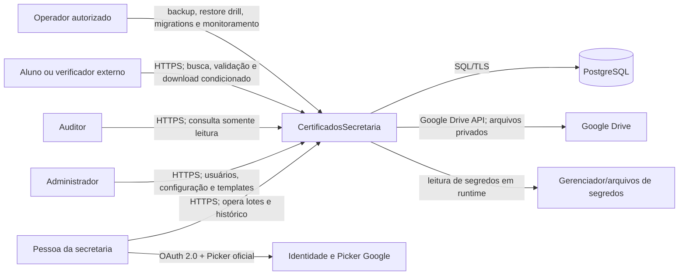
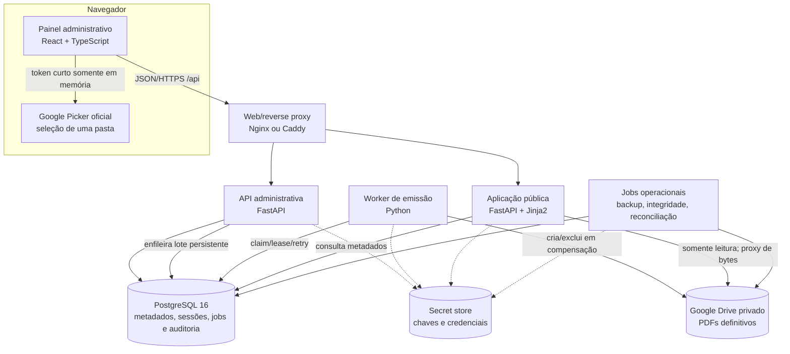
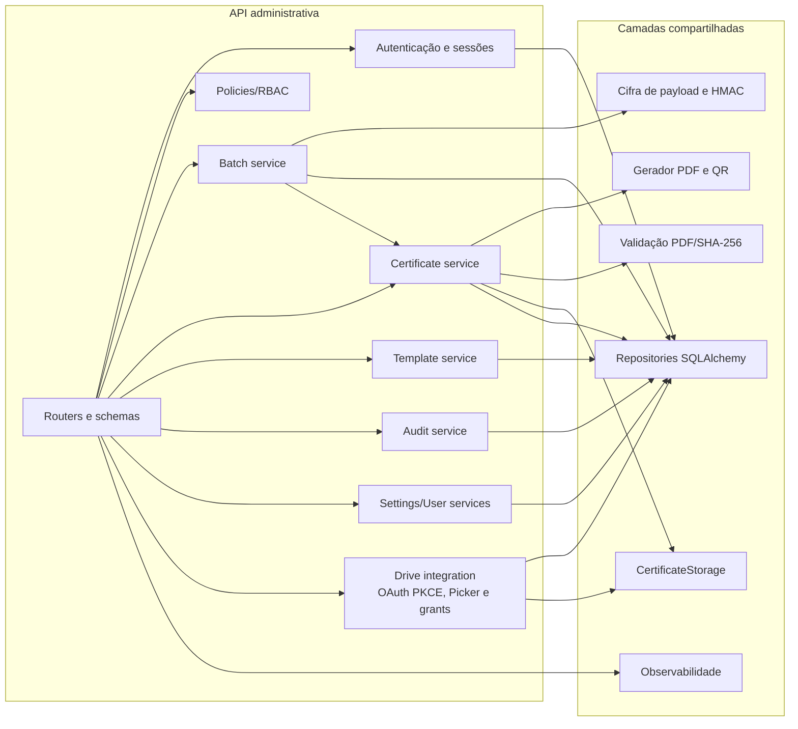

# Arquitetura C4

Versão documental: 14 de agosto de 2026. Os diagramas usam Mermaid e descrevem
o código versionado, não um ambiente implantado.

## Nível 1 — contexto

Fora do escopo do sistema: identidade institucional federada, assinatura digital
ICP-Brasil, envio de e-mail e armazenamento público de arquivos. O código não
implementa esses recursos.

## Nível 2 — containers

Em desenvolvimento, SQLite e storage local substituem PostgreSQL e Drive. Essa
substituição existe para teste local e não é a arquitetura de produção.

## Nível 3 — componentes do backend

## Decisões e consequências

| Decisão | Motivo | Consequência real |
|---|---|---|
| PostgreSQL como fonte de verdade em produção | transações, concorrência, constraints e workers múltiplos | requer migrations, TLS, backup e operação do banco. |
| PDFs fora do banco | separar metadados de binários e usar Drive privado | não há transação distribuída; a saga deve compensar/reconciliar. |
| API pública separada | superfície e escala distintas | compartilha PostgreSQL e lê arquivos nas pastas registradas, com identidade Drive distinta e somente leitura. |
| uma pasta por evento | impedir mistura entre eventos e manter destino reproduzível | o mapa `evento -> folder_id` entra cifrado no contexto do lote e fica imutável durante retry. |
| sessão server-side mais JWT | logout/revogação efetivos | cada requisição autenticada consulta estado de sessão. |
| lote persistente e cifrado | sobreviver a restart sem gravar planilha em claro | exige chave AES-GCM versionada e rotina de retenção. |
| template imutável por versão | reemissão reproduzível e auditoria | imagens/layout aumentam o banco e precisam de backup. |

## Limites de confiança

1. Internet → reverse proxy: entrada não confiável, TLS e headers restritos.
2. Navegador admin → API: cookie HttpOnly, proteção de origem e RBAC no servidor.
3. Serviços → PostgreSQL: credencial de aplicação e TLS verificado em produção.
4. Serviços → Drive: identidades separadas de escrita e somente leitura.
5. Runtime → secrets: valores nunca entram no repositório nem nas respostas.

O OAuth pessoal usa authorization code com PKCE, `state` aleatório consumido
uma única vez e somente o escopo `drive.file`. Não é armazenado refresh token.
Depois da validação, a pasta permanece privada e é compartilhada somente com
as identidades técnicas configuradas de escrita e leitura.

A migration `0009` adiciona o estado OAuth transitório cifrado e grants de
pastas validados. O mapa evento→pasta fica no contexto AES-GCM do lote, não no
navegador. Cada certificado persiste `drive_folder_id`; retry, reemissão,
consulta, backup e reconciliação usam esse destino original.
