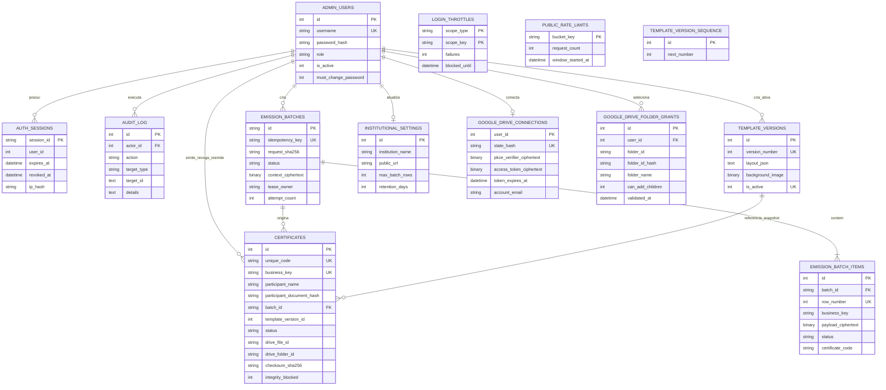

# Diagrama entidade-relacionamento

O diagrama resume as entidades da migration `0009`. Alguns campos operacionais
foram omitidos visualmente; os modelos em `database/models.py` e as migrations
são a fonte de verdade.

Observações:

- o PDF não é armazenado em `CERTIFICATES`; ficam apenas localizador e metadados;
- `participant_document_hash` é HMAC versionado; o documento em claro é
  minimizado quando a configuração segura está ativa;
- `business_key` e `idempotency_key` resolvem problemas distintos: duplicidade
  acadêmica por linha e repetção da requisição de lote;
- `EMISSION_BATCH_ITEMS` usa chave composta única `(batch_id, row_number)`;
- o mapa evento→pasta fica cifrado em `EMISSION_BATCHES.context_ciphertext`;
- conexões OAuth guardam apenas material transitório cifrado, sem refresh token;
- somente uma versão de template pode estar ativa por vez.
