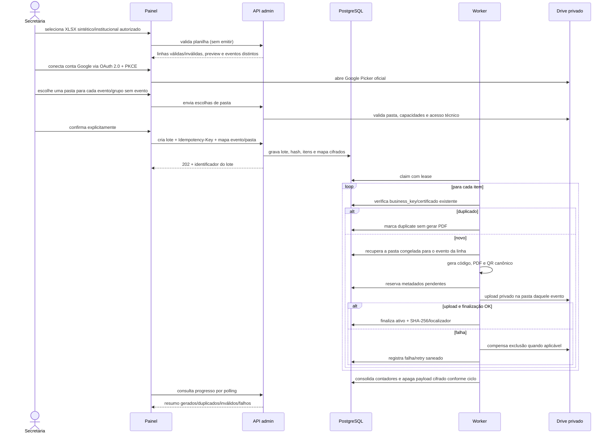
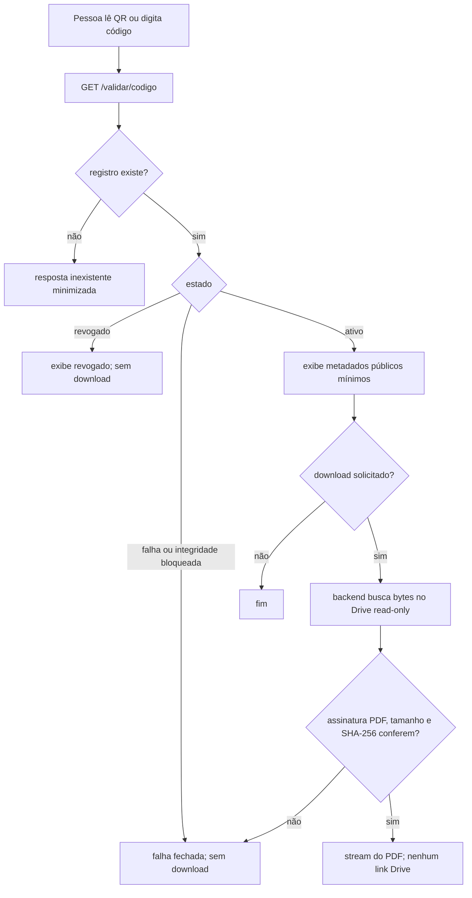

# Fluxos principais

## Emissão

A idempotência do lote exige que uma mesma `Idempotency-Key` represente o mesmo
hash de planilha, parâmetros e destinos; reutilização conflitante recebe `409`.
O backend exige correspondência exata entre os eventos validados e as pastas,
inclusive a chave vazia do grupo **Certificados sem evento**. O mapa cifrado fica
congelado no lote para retry e retomada. O worker possui lease, heartbeat e
tentativas limitadas. A saga é necessária porque PostgreSQL e Google Drive não
compartilham uma transação ACID.

## Reemissão

A reemissão usa o `drive_folder_id` já registrado no certificado, não uma
pasta escolhida em um lote posterior. O novo PDF é criado nessa pasta e
finalizado no PostgreSQL antes da compensação do arquivo anterior. Se o registro
legado não tiver pasta e o storage for Drive, a operação falha fechada em vez de
misturar o documento em um destino atual.

## Validação pública

## Busca nominal

A busca por nome usa `POST`, não devolve o código do certificado e fornece uma
referência opaca que não autoriza download isoladamente. O download originado
dessa busca exige confirmação do Registro Acadêmico (RA) comparada por HMAC. A
consulta também aceita busca direta pelo RA e retorna todos os certificados
relacionados, sem expor o RA na resposta. A resposta para referência inexistente,
dado incorreto e registro sem dado de
confirmação é deliberadamente genérica.
