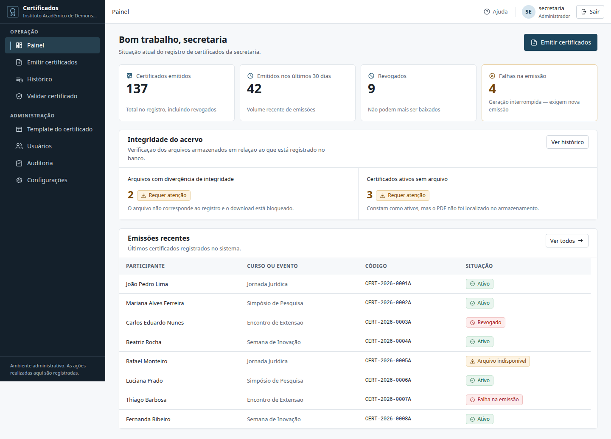
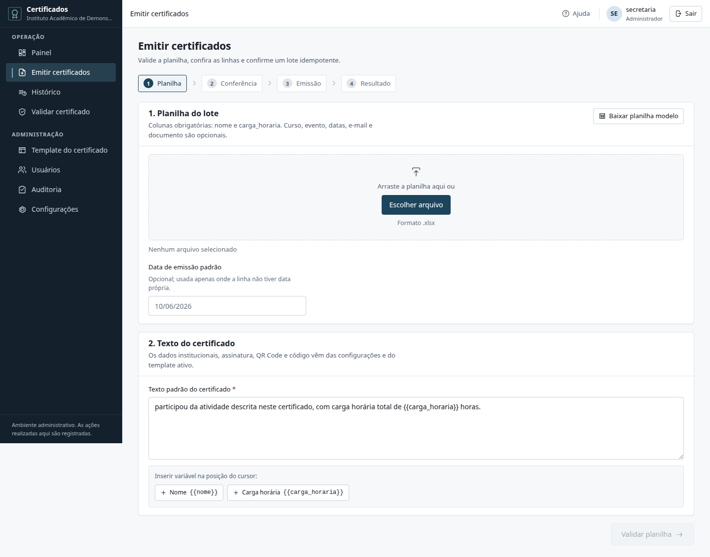
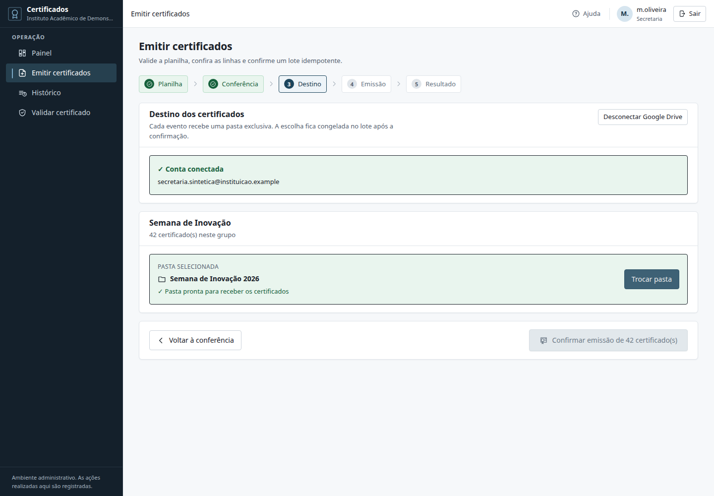
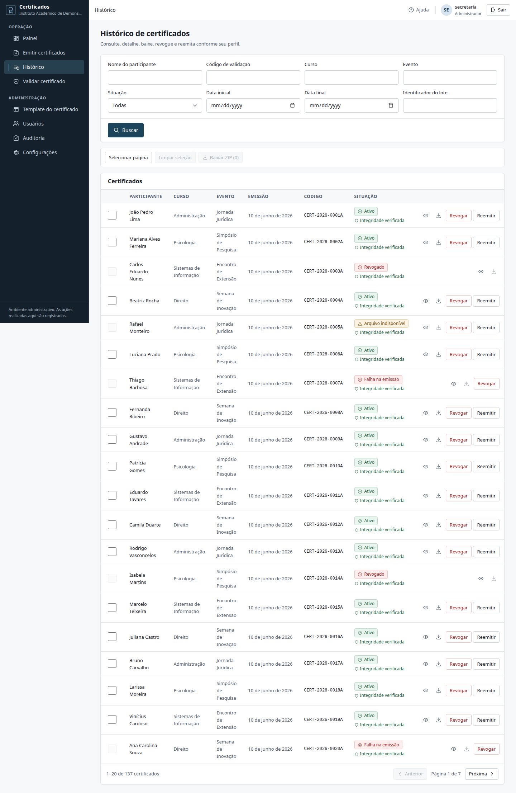
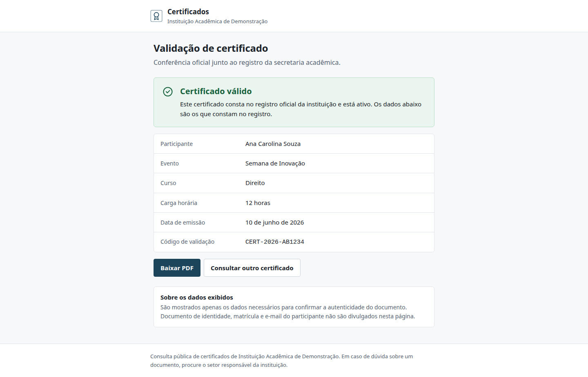

# Relatório técnico final — CertificadosSecretaria

**Versão:** 13 de agosto de 2026
**Natureza:** entrega acadêmica; nenhum deploy realizado
**Dados das evidências:** exclusivamente sintéticos
**Fonte de prontidão:** `docs/RELATORIO_DE_PRONTIDAO_FINAL.md`

## Resumo

O CertificadosSecretaria é um sistema para preparar lotes, emitir PDFs com
código/QR, administrar o ciclo de vida e permitir validação pública com
minimização de dados. A versão atual é substancialmente diferente do relatório
de junho de 2026: possui autenticação, sessões revogáveis, RBAC, PostgreSQL de
produção, Google Drive privado, lote persistente e auditoria. O documento antigo
foi movido para `docs/historico/` e identificado como obsoleto.

O relatório descreve o que existe no código. Resultados de auditoria, commits e
riscos aceitos não são presumidos: constam somente no relatório de prontidão
gerado após a execução em checkout limpo.

## 1. Problema acadêmico

Emissão manual ou fragmentada de certificados cria retrabalho, divergência de
dados, duplicidades, dificuldade de localizar/revogar e baixa confiança na
verificação por terceiros. Planilhas e PDFs também carregam dados pessoais e não
podem ser tratados como artefatos públicos. O problema de engenharia é conciliar
usabilidade da secretaria, consistência entre banco e arquivo, validação pública,
controle de acesso, rastreabilidade, privacidade e recuperação.

## 2. Objetivos

### Objetivo geral

Disponibilizar uma base reprodutível para emitir e validar certificados
acadêmicos com controles de segurança, integridade e operação proporcionais ao
tratamento de dados pessoais.

### Objetivos específicos

- validar a planilha antes de qualquer emissão;
- tornar repetição de requisição e de participante detectáveis/idempotentes;
- gerar PDF com código único e QR para rota oficial;
- preservar histórico, revogação, reemissão e template utilizado;
- separar administração autenticada de consulta pública minimizada;
- manter PDFs privados e verificar seus bytes antes do download;
- operar migrations, worker, backup/restore, reconciliação e auditoria;
- produzir entrega sem credencial, PII ou artefato de runtime.

## 3. Requisitos

Os requisitos funcionais cobrem autenticação/sessão, três papéis, gestão de
usuários, planilha, preview, lote, PDF/QR, histórico, ZIP, revogação,
reemissão, templates, auditoria, configuração, validação/busca pública e backup.
Os não funcionais incluem privacidade, integridade, concorrência, durabilidade,
acessibilidade, reprodutibilidade, observabilidade e recuperação. A matriz
completa, status e evidências está em [MATRIZ_DE_REQUISITOS.md](MATRIZ_DE_REQUISITOS.md).

## 4. Arquitetura e decisões

O painel React acessa a API administrativa por uma borda web. A API pública é
um FastAPI/Jinja2 separado. API, consulta, worker e jobs compartilham PostgreSQL;
worker/admin escrevem no Drive e a consulta recebe perfil somente leitura. Os
segredos são fornecidos em runtime.

As visões C4 estão em [ARQUITETURA_C4.md](ARQUITETURA_C4.md), o modelo de dados
em [DIAGRAMA_ER.md](DIAGRAMA_ER.md) e as sequências em [FLUXOS.md](FLUXOS.md).

Decisões centrais:

- PostgreSQL é a fonte de verdade em produção; SQLite é adaptador de dev/teste;
- PDF fica fora do banco, exigindo saga e reconciliação;
- templates e configurações usados na emissão são congelados para reemissão;
- lote é job persistente, não tarefa em memória do request;
- frontend orienta permissões, mas a autorização decisiva fica no backend;
- respostas públicas e auditoria usam projeções allowlist.

## 5. Autenticação e RBAC

Senha é armazenada com bcrypt. No login, a API cria JWT com `jti` e registro de
sessão no banco; logout, troca de senha, inativação e revogação administrativa
podem invalidá-lo antes do vencimento. Cookies são HttpOnly e, em produção,
Secure; mutações por cookie validam origem. Tentativas falhas alimentam throttle
persistente e compartilhado.

Papéis:

| Capacidade | admin | secretaria | auditor |
|---|---:|---:|---:|
| emitir, histórico e download | sim | sim | leitura do histórico, sem download |
| revogar/reemitir | sim | configurável | não |
| templates, usuários e configurações | sim | não | não |
| auditoria | sim | não | somente leitura |

Papel desconhecido recebe nenhuma permissão. A matriz executável reside em
`certificados-admin/backEnd/policies.py` e deve receber teste negativo a cada
nova capacidade.

## 6. Idempotência, durabilidade e saga

A `Idempotency-Key` identifica a criação do lote e é vinculada ao SHA-256 da
requisição. Mesma chave e mesmo hash retornam o lote; mesma chave e hash distinto
conflitam. Cada linha ainda possui `business_key` acadêmica única.

A migration `0008` introduz itens de lote cifrados, tentativas, `next_attempt_at`,
lease, heartbeat e estados terminais. O worker pode retomar lote abandonado sem
depender do processo HTTP. Payloads usam AES-GCM com AAD e key id; adulteração
falha fechada e é auditada.

A migration `0009` acrescenta o estado OAuth transitório cifrado e os grants de
pastas validados. O mapa `evento -> folder_id` entra no hash idempotente e no
contexto AES-GCM do lote, permanecendo imutável em reinícios e retries.

PostgreSQL e Drive não oferecem commit atômico conjunto. A emissão reserva
metadados, gera/upload, finaliza e compensa o arquivo quando a finalização
falha. Resíduos e estados incompletos exigem reconciliação; isso é uma limitação
inerente, não uma transação distribuída implícita.

## 7. PostgreSQL

Produção exige `DATABASE_URL` PostgreSQL e TLS verificado conforme a validação
de configuração. SQLAlchemy/repositórios delimitam transações; constraints
protegem códigos, chaves, papéis e estados. Alembic é a fonte de verdade do
schema (`0001` a `0009`). Banco e imagens de template fazem parte do backup.

## 8. Google Drive privado

O Drive guarda PDFs definitivos sem compartilhamento público. Depois da
conferência, a Secretaria autentica via OAuth 2.0 com PKCE e escolhe uma pasta
por evento no Picker oficial (`drive.file`). O backend valida tipo, lixeira,
`canAddChildren` e compartilhamento com identidades técnicas. O token pessoal é
curto, cifrado no banco e não possui refresh token; o worker usa sua credencial
técnica durável.

O worker persiste `drive_file_id` e `drive_folder_id` em cada certificado.
Consulta, reemissão, backup e reconciliação usam a pasta registrada, nunca a
seleção atual da tela. A consulta usa identidade distinta somente leitura e
devolve bytes por proxy, sem URL ou IDs internos.

Esta entrega não executou integração contra uma conta Drive real. O comportamento
automatizado usa doubles/fakes; OAuth, Picker e permissões reais ainda devem ser
validados em staging antes da produção.

## 9. Integridade, PDF e QR Code

Na gravação são persistidos MIME, tamanho e SHA-256. Antes de servir, o backend
verifica assinatura PDF, limite/tamanho e checksum; divergência bloqueia o
download. Isso detecta corrupção/adulteração dos bytes, mas não equivale a
assinatura digital jurídica.

Cada certificado recebe código único e QR para
`PUBLIC_VALIDATION_BASE_URL/validar/<codigo>`. Em produção, a base precisa ser
HTTPS explícita. Testes de contrato devem garantir que a rota impressa existe.

## 10. Privacidade

Busca nominal usa `POST`, resposta `no-store`, nome mascarado e referência opaca
sem código. Também é possível pesquisar diretamente pelo Registro Acadêmico
(RA) e recuperar todos os certificados relacionados. O download por nome ou RA
exige confirmação do RA comparado por HMAC versionado. RA em claro é minimizado;
e-mail, hash, IDs e links internos não aparecem publicamente. Rate limit usa
chaves pseudonimizadas no banco.

O modelo de ameaças e a política estão em
[MODELO_DE_AMEACAS.md](MODELO_DE_AMEACAS.md) e
[POLITICA_SEGURANCA_LGPD.md](POLITICA_SEGURANCA_LGPD.md). A instituição ainda
precisa definir base legal, retenção e atendimento de direitos.

## 11. Evidências visuais atuais

As imagens foram geradas do build atual em viewport desktop de 1440 px, com API
mock versionada e dados sintéticos. Não contêm credenciais nem representam ambiente implantado.
O conjunto responsivo cobre também 320, 375, 768 e 1366 px; a auditoria mecânica
está em `docs/screenshots/auditoria-mecanica.json`.

### Painel administrativo

### Preparação da emissão

### Destino por evento no Google Drive

### Histórico e ciclo de vida

### Validação pública

## 12. Testes

O plano inclui instalação bloqueada, lint, formatação, tipos, unitários,
PostgreSQL, migrations, frontend, E2E, axe, build, audits, containers, scanner,
backup/restore e smoke. O detalhamento está em [PLANO_TESTES.md](PLANO_TESTES.md).

Números e resultados finais devem ser lidos em
[RELATORIO_DE_PRONTIDAO_FINAL.md](RELATORIO_DE_PRONTIDAO_FINAL.md); resultados
históricos não foram reaproveitados como prova da entrega.

## 13. Deploy e operação

O repositório fornece imagens separadas de runtime, operações e web, além de
compose e configurações de proxy. Migrations rodam como etapa explícita; o worker
é processo separado. Produção requer PostgreSQL gerenciado/operado, HTTPS,
segredos, identidades Drive separadas, backup externo, monitoramento e runbooks.

Nenhum deploy foi feito. O [manual de instalação](MANUAL_INSTALACAO.md) descreve
somente preparação local e requisitos; a checklist de produção não autoriza
implantação.

## 14. Backup e recuperação

`certificados-backup` cria artefatos PostgreSQL/PDF cifrados com AES-256-GCM,
verifica autenticação e restringe restore a banco descartável nomeado. Produção
exige destino GCS dedicado. O plano e as lacunas de RPO/RTO estão em
[PLANO_BACKUP_RECUPERACAO.md](PLANO_BACKUP_RECUPERACAO.md). A entrega só pode
ser declarada pronta se o relatório final registrar restore realmente executado.

## 15. Custos

Não houve custo observado porque não houve deploy. Custos futuros dependem de
compute para API/worker, PostgreSQL, backups, tráfego, cotas/armazenamento Drive,
segredos e observabilidade. Região, volume e contrato não foram definidos; por
isso não se inventa estimativa monetária. Uma cotação datada é trabalho de
pré-produção.

## 16. Limitações e trabalhos futuros

As limitações incluem ausência de staging/Drive real, E2E integrado completo,
MFA/SSO, assinatura digital, metas de carga/SLA, auditoria manual de
acessibilidade e RPO/RTO aprovados. A lista priorizada está em
[LIMITACOES_TRABALHOS_FUTUROS.md](LIMITACOES_TRABALHOS_FUTUROS.md).

## 17. Conclusão

A arquitetura atual resolve o núcleo acadêmico com controles explícitos para
acesso, duplicidade, falha parcial, integridade e privacidade. Isso não autoriza
afirmar que o sistema está pronto para produção. O veredito desta entrega é
condicionado à auditoria reproduzida e aos riscos residuais do relatório de
prontidão; a checklist de produção permanece separada da demonstração.
